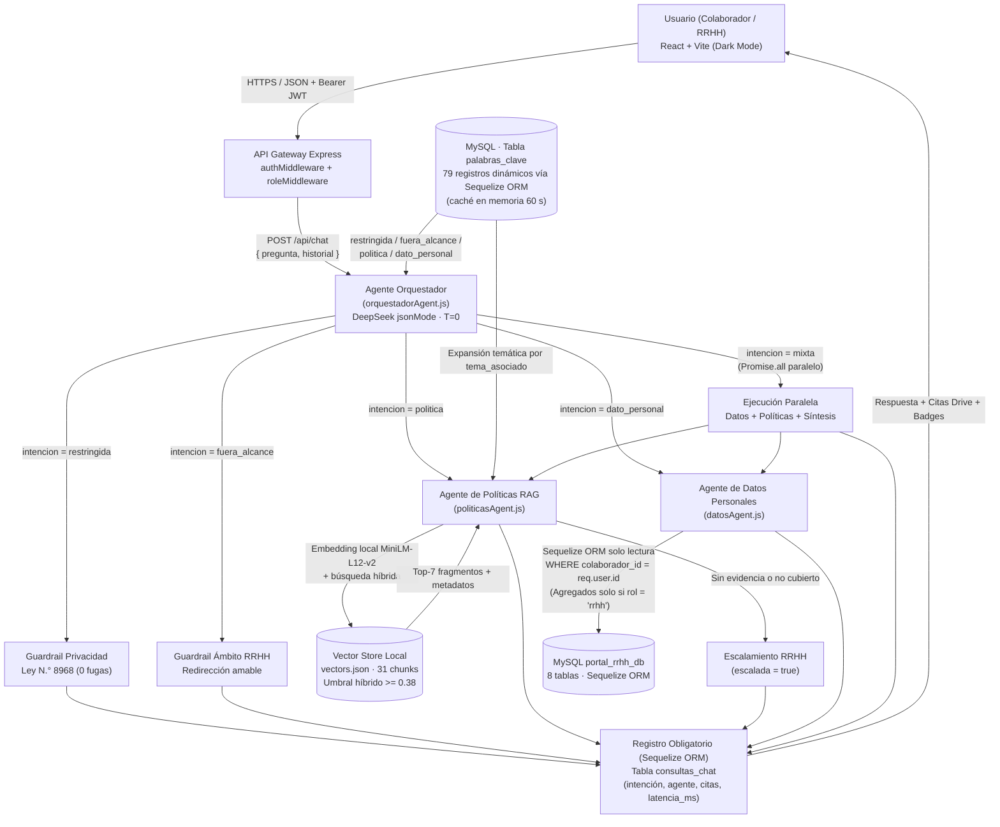
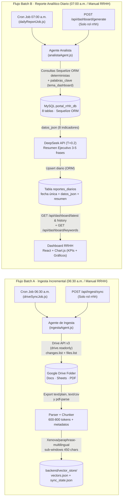

# Diagrama de Arquitectura del Sistema Multiagente RAG

| Campo | Detalle |
| :--- | :--- |
| **Proyecto** | Portal Interno de Consulta de Políticas de RRHH con RAG Multiagente |
| **Empresa Modelo** | NovaCore Technologies Costa Rica S.A. |
| **Versión** | `v1.1` (8 tablas MySQL · 100 % Sequelize ORM) |
| **Fecha** | 17 de noviembre de 2026 |

---

## 1. Visión General de Flujos Independientes

La arquitectura del portal separa estrictamente la **ruta interactiva en tiempo real** (consultas conversacionales de colaboradores y personal de RRHH) de los **flujos batch programados** (sincronización incremental con Google Drive a las `06:30 a.m.` y generación del reporte ejecutivo diario a las `07:00 a.m.`). Toda la persistencia relacional y la gestión dinámica de palabras clave (`palabras_clave`) operan exclusivamente mediante **Sequelize ORM (cero SQL crudo)**.

---

## 2. Flujo 1: Conversacional en Tiempo Real (Chat Multiagente)

---

## 3. Flujo 2: Ingesta Incremental (`06:30 a.m.`) y Reporte Analítico Diario (`07:00 a.m.`)

---

## 4. Descripción por Capas y Control de Acceso (RBAC)

1. **Capa de Presentación (`frontend/`):** SPA React + Vite en modo oscuro corporativo (`#0B1120` / `#111827`) con acentos esmeralda (`#10B981`). `ProtectedRoute.jsx` y `Navbar.jsx` ocultan y bloquean `/dashboard` para usuarios sin `rol === 'rrhh'`.
2. **Capa API y Seguridad (`backend/src/routes`, `middlewares`, `controllers`):** Express con validación `zod`, hashing `bcryptjs`, tokens JWT de `8h` (`authMiddleware.js`) y verificación de rol (`roleMiddleware.js`).
   - Rutas públicas: `GET /api/health`, `POST /api/auth/login`.
   - Rutas autenticadas: `GET /api/auth/me`, `POST /api/chat`, `GET /api/chat/history`, `GET /api/ingest/status`.
   - Rutas exclusivas `rrhh`: `POST /api/ingest/sync`, `GET /api/dashboard/latest`, `GET /api/dashboard/history`, `POST /api/dashboard/generate`, `GET /api/dashboard/keywords`.
3. **Capa Multiagente (`backend/src/agents`):** Cinco agentes especializados coordinados sin listas de palabras clave hardcodeadas en JS; todas las reglas léxicas y temáticas se leen desde la tabla `palabras_clave` mediante Sequelize ORM.
4. **Capa de Datos (`backend/src/models`, `migrations`, `seeders`, `rag`):** 8 tablas en MySQL gestionadas 100 % por Sequelize ORM (`colaboradores`, `saldos_vacaciones`, `solicitudes`, `incapacidades`, `movimientos_personal`, `consultas_chat`, `reportes_diarios`, `palabras_clave`) más el almacén vectorial local persistente en `backend/vector_store/vectors.json`.
