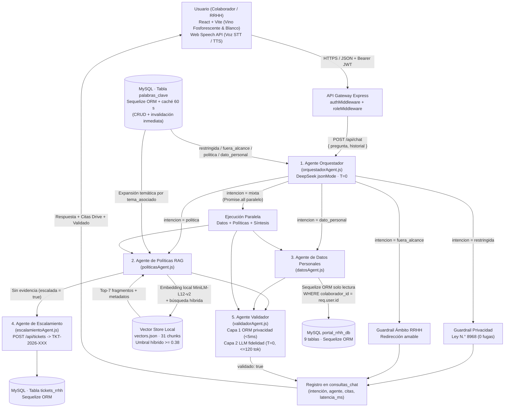
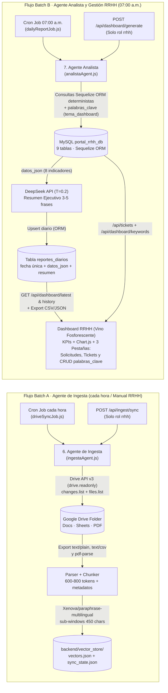

# Diagrama de Arquitectura del Sistema Multiagente RAG

| Campo | Detalle |
| :--- | :--- |
| **Proyecto** | Portal Interno de Consulta de Políticas de RRHH con RAG Multiagente |
| **Empresa Modelo** | NovaCore Technologies Costa Rica S.A. |
| **Versión** | `v1.3` (9 tablas MySQL · 7 Agentes · 100 % Sequelize ORM · UI Vino Fosforescente & Blanco) |
| **Fecha** | 18 de noviembre de 2026 |

---

## 1. Visión General de Flujos Independientes

La arquitectura del portal separa estrictamente la **ruta interactiva en tiempo real** (consultas conversacionales con voz, validación de fidelidad/privacidad y creación de tickets) de los **flujos batch programados** (sincronización con Google Drive cada hora y `07:00 a.m.` generación del reporte analítico diario). Toda la persistencia relacional —incluyendo las **9 tablas** en MySQL y la gestión dinámica de `palabras_clave` y `tickets_rrhh`— opera exclusivamente mediante **Sequelize ORM (cero SQL crudo)**.

---

## 2. Flujo 1: Conversacional en Tiempo Real (Chat Multiagente + Validador + Tickets)

---

## 3. Flujo 2: Ingesta Incremental (`cada hora`) y Reporte Analítico Diario (`07:00 a.m.`)

---

## 4. Descripción por Capas y Control de Acceso (RBAC)

1. **Capa de Presentación (`frontend/`):** SPA React + Vite en estética corporativa **Vino Fosforescente y Blanco Puro** (`#E6004C`, `#FF1764`, `#FFF0F5`, `#FFFFFF`, `#F8F9FB`), con dictado/lectura por voz (Web Speech API), notificaciones Toast, tickets en vivo en `/chat` y `/dashboard`, panel inferior organizado en 3 pestañas con gestor visual CRUD de `palabras_clave` y exportación CSV/JSON.
2. **Capa API y Seguridad (`backend/src/routes`, `middlewares`, `controllers`):** Express con validación `zod`, hashing `bcryptjs`, JWT (`authMiddleware.js`) y RBAC (`roleMiddleware.js`).
   - Públicas: `GET /api/health`, `POST /api/auth/login`.
   - Autenticadas: `GET /api/auth/me`, `POST /api/chat`, `GET /api/chat/history`, `GET /api/ingest/status`, `POST /api/tickets`, `GET /api/tickets/mine`.
   - Exclusivas `rrhh`: `POST /api/ingest/sync`, `GET /api/dashboard/latest`, `GET /api/dashboard/history`, `POST /api/dashboard/generate`, `GET/POST/PATCH/DELETE /api/dashboard/keywords`, `GET /api/tickets`, `PATCH /api/tickets/:id/resolve`.
3. **Capa Multiagente (`backend/src/agents` — 7 agentes):** `orquestadorAgent`, `politicasAgent`, `datosAgent`, `validadorAgent`, `escalamientoAgent`, `ingestaAgent`, `analistaAgent`.
4. **Capa de Datos (`backend/src/models`, `migrations`, `seeders`, `rag`):** **9 tablas** en MySQL (`colaboradores`, `saldos_vacaciones`, `solicitudes`, `incapacidades`, `movimientos_personal`, `consultas_chat`, `reportes_diarios`, `palabras_clave`, `tickets_rrhh`) gobernadas al **100 % con Sequelize ORM**.
